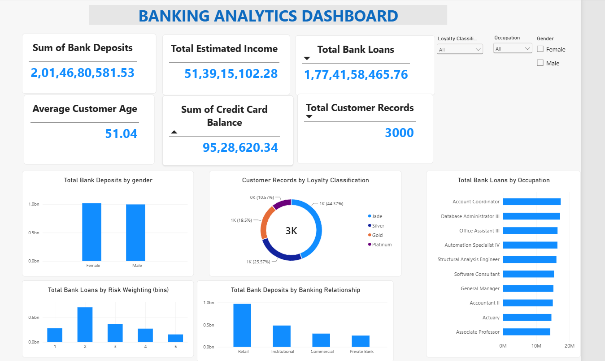

# 🏦 Banking Analytics Dashboard | Power BI

### Data Analytics | Business Intelligence | Financial Reporting

---

## 📌 Project Overview

The **Banking Analytics Dashboard** is a business intelligence project developed using Microsoft Power BI to analyze banking data and present key financial and customer-related information through interactive visualizations.

The project demonstrates practical experience in:

- Data Cleaning and Transformation
- Data Validation and Quality Checks
- KPI Development
- DAX Calculations
- Interactive Dashboard Development
- Business Performance Analysis
- Data Visualization and Reporting

**Objective:** Transform raw banking data into meaningful insights that support business reporting and decision-making.

---

## 📊 Dashboard Preview

[📥 View or Download Power BI Dashboard](./Banking_Analytics_Dashboard.pbix)

> The screenshot displays the completed Banking Analytics Power BI dashboard.

---

## 🎯 Project Objectives

1. Analyze banking data and financial performance.
2. Develop business performance KPIs.
3. Examine customer segments and banking trends.
4. Create interactive Power BI visualizations.
5. Identify patterns and performance differences.
6. Present findings through a professional dashboard.

---

## 🛠️ Tools & Technologies

| Technology | Application |
|------------|-------------|
| Microsoft Power BI | Interactive dashboard |
| Power Query | Data cleaning and transformation |
| DAX | Calculated measures and KPIs |
| Data Modeling | Data structure and relationships |
| Excel | Data source and validation |
| Power BI Visuals | Charts, KPI cards, and slicers |

---

## 📈 Key Performance Indicators

The dashboard can be used to evaluate banking metrics such as:

| KPI | Business Purpose |
|-----|------------------|
| Total Customers | Monitor customer base |
| Total Deposits | Analyze deposit portfolio |
| Total Loans | Evaluate lending portfolio |
| Total Balance | Measure account balances |
| Average Balance | Understand average account value |

*Only KPIs present in the final Power BI report should be treated as implemented metrics.*

---

## 🧹 Data Cleaning & Preparation

The dataset was reviewed and prepared before analysis.

### Data Quality Checks

- Checked for missing and null values.
- Identified duplicate records.
- Validated data types.
- Reviewed numerical and categorical columns.
- Checked data consistency.
- Prepared fields for reporting and analysis.

### Data Transformation

Power Query can be used for:

- Correcting column data types.
- Renaming columns for readability.
- Handling missing values.
- Creating calculated or derived columns.
- Preparing tables for data modeling.

---

## 🧮 DAX Measures

DAX enables dynamic calculations and KPI reporting in Power BI.

The following are illustrative examples of banking-related measures.

### Total Customers

\`\`\`dax
Total Customers =
DISTINCTCOUNT(Banking[CustomerID])
\`\`\`

### Total Deposits

\`\`\`dax
Total Deposits =
SUM(Banking[Deposits])
\`\`\`

### Total Loans

\`\`\`dax
Total Loans =
SUM(Banking[Loans])
\`\`\`

### Average Balance

\`\`\`dax
Average Balance =
AVERAGE(Banking[Balance])
\`\`\`

> Note: These examples must be replaced with the actual measures, table names, and column names from the Power BI model before claiming they were implemented.

---

## 📉 Dashboard Analysis

### 1. Customer Analysis

Analyze customer distribution across relevant segments and demographic categories.

### 2. Financial Analysis

Explore deposits, loans, balances, and other available financial measures.

### 3. Segment Analysis

Compare performance across customer and banking categories.

### 4. Interactive Reporting

Use available slicers and filters to explore the data from different perspectives.

---

## 💡 Business Insights

This dashboard supports the investigation of:

- Which customer segments contribute most to banking performance.
- How deposits and loans vary across categories.
- How customer and financial metrics differ across groups.
- Where opportunities for deeper financial analysis exist.

Specific numerical findings should be documented after validating the final dashboard values.

---

## 📁 Repository Structure

\`\`\`text
Banking-Analytics-PowerBI/
│
├── Banking_Analytics_Dashboard.pbix
├── Banking_Analytics_Dashboard.png
└── README.md
\`\`\`

---

## 🚀 How to Use This Project

1. Download the Power BI `.pbix` file.
2. Open it using Microsoft Power BI Desktop.
3. Navigate to the dashboard page.
4. Explore the KPI cards and visualizations.
5. Use the available slicers to analyze different segments.
6. Review the findings and business insights.

---

## 🎓 Skills Demonstrated

- Power BI Dashboard Development
- Data Cleaning and Validation
- Data Modeling
- DAX Calculations
- KPI Reporting
- Business Intelligence
- Data Visualization
- Analytical Reporting

---

## 👨‍💻 About the Author

**Gurudev Mishra**

Data Analyst | MIS Reporting | Business Intelligence

**Technical Skills:** SQL, Python, Power BI, Tableau, Advanced Excel

📍 Mumbai, Maharashtra, India

🔗 [GitHub Profile](https://github.com/Gurudevmishra)

---

### ⭐ Turning Data into Insights and Insights into Decisions

